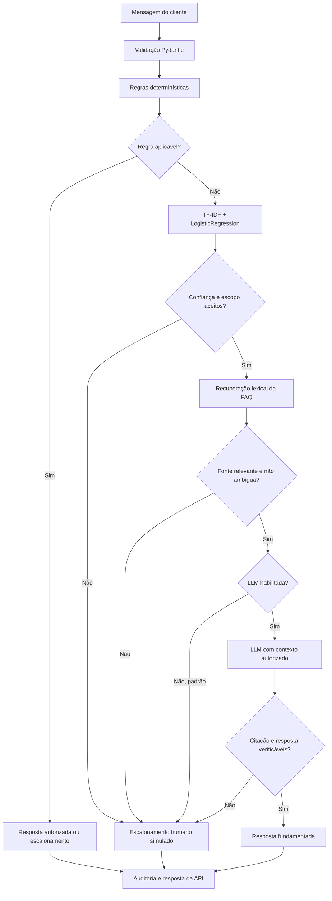

# Micro-capstone M1D1 — Atendimento inteligente em e-commerce

Projeto acadêmico da pós-graduação em Inteligência Artificial para avaliação de
um caso de uso de atendimento ao cliente. O repositório demonstra uma
arquitetura híbrida e rastreável que combina regras determinísticas,
classificação de intenção por Machine Learning, recuperação lexical de
conhecimento, integração opcional com LLM e escalonamento humano.

> **Aviso acadêmico:** todos os tickets, FAQs, rótulos e políticas usados na
> implementação são sintéticos ou fictícios. Os únicos dados fornecidos pelo
> caso são o volume aproximado de 25.000 solicitações mensais, o tempo médio
> inicial de resposta de 9 horas e o atendimento 100% humano. Não há dados
> pessoais, métricas reais de produção, CSAT, economia ou taxa de resolução.

## Problema de negócio

O cenário descreve um e-commerce fictício com alto volume de suporte, resposta
média de 9 horas, custo operacional elevado e atendimento integralmente humano.
O objetivo é avaliar como reduzir tempo e custo sem comprometer qualidade,
segurança, explicabilidade ou confiança.

As alternativas analisadas são:

1. regras e fluxos determinísticos;
2. classificação de intenções com Machine Learning;
3. LLM controlado por fontes autorizadas;
4. arquitetura híbrida com fallback humano.

## Arquitetura híbrida implementada



Precedência efetiva: regras → ML → recuperação → LLM opcional → humano. O ML
classifica e roteia, mas não autoriza políticas. A LLM fica desligada por padrão
e nenhuma LLM real foi avaliada neste estudo.

## Stack tecnológica

| Camada | Tecnologias |
| --- | --- |
| Backend | Python ≥ 3.10, FastAPI, Pydantic, Uvicorn |
| Machine Learning | scikit-learn, TF-IDF, LogisticRegression |
| Recuperação | TF-IDF e similaridade de cosseno sobre FAQ local |
| LLM opcional | Adaptador HTTP compatível com chat completions, desabilitado por padrão |
| Frontend | React 19, TypeScript, Vite 7, CSS responsivo |
| Testes | pytest, Vitest, Testing Library, JSDOM |

O ambiente da validação final utilizou Python 3.14.3, Node.js 24.11.1 e npm
11.14.1. O Vite instalado requer Node.js `^20.19.0` ou `>=22.12.0`.

## Estrutura do repositório

```text
backend/
  app/                  API, regras, ML, recuperação, LLM e schemas
  tests/                testes unitários e de integração
data/                   dataset sintético versionado, 125 mensagens
docs/                   análises, avaliações e documentação final
examples/               amostra sintética inicial
frontend/
  src/                  chat, explicabilidade, dashboard e testes
knowledge/              FAQ fictícia autorizada
scripts/                avaliação ML e comparação de roteamento
pyproject.toml           dependências e configuração Python
```

## Instalação no Windows PowerShell

Pré-requisitos:

- Python 3.10 ou superior;
- Node.js compatível com Vite 7;
- Git, apenas para clonar e versionar localmente.

Na raiz do repositório:

```powershell
python -m venv .venv
.\.venv\Scripts\Activate.ps1
python -m pip install --upgrade pip
python -m pip install -e ".[test]"

Set-Location frontend
npm install
Set-Location ..
```

Nenhuma chave é necessária no modo padrão. Os arquivos `.env.example` documentam
somente configurações opcionais e não contêm segredos.

## Execução

Terminal 1 — backend, a partir da raiz:

```powershell
.\.venv\Scripts\Activate.ps1
$env:LLM_ENABLED = "false"
python -m uvicorn backend.app.main:app --reload
```

- API: `http://127.0.0.1:8000`
- OpenAPI/Swagger: `http://127.0.0.1:8000/docs`

Terminal 2 — frontend:

```powershell
Set-Location frontend
npm run dev
```

- Interface: `http://127.0.0.1:5173`
- API padrão do frontend: `http://127.0.0.1:8000`

O CORS aceita exclusivamente as origens locais `http://127.0.0.1:5173` e
`http://localhost:5173`.

## Exemplos da API

Saúde:

```powershell
Invoke-RestMethod -Method Get -Uri "http://127.0.0.1:8000/health"
```

Mensagem coberta por regra:

```powershell
$body = @{ message = "Onde vejo o rastreio?" } | ConvertTo-Json
Invoke-RestMethod -Method Post `
  -Uri "http://127.0.0.1:8000/support/messages" `
  -ContentType "application/json" `
  -Body $body
```

Mensagem sem política autorizada:

```powershell
$body = @{ message = "Meu cartão foi recusado mesmo com limite" } | ConvertTo-Json
Invoke-RestMethod -Method Post `
  -Uri "http://127.0.0.1:8000/support/messages" `
  -ContentType "application/json" `
  -Body $body
```

A resposta inclui `correlation_id`, rota, intenção, resposta segura, indicador de
escalonamento e auditoria com motivo, duração, versão do modelo e fontes quando
aplicável.

## Testes e reprodução dos experimentos

Backend:

```powershell
python -m pytest
```

Avaliação do classificador e comparação de estratégias:

```powershell
python scripts/evaluate_ml.py
python scripts/compare_routing.py
```

Frontend:

```powershell
Set-Location frontend
npm test
npm run build
```

## Resultados observados

### Classificador

Dataset sintético balanceado com 125 mensagens, 25 por classe, e divisão
estratificada reproduzível com seed 42: 87 treino, 19 validação e 19 teste.

| Conjunto | Accuracy | Precision macro | Recall macro | Macro F1 |
| --- | ---: | ---: | ---: | ---: |
| Validação, 19 casos | 0,579 | 0,567 | 0,567 | 0,559 |
| Teste, 19 casos | 0,684 | 0,733 | 0,700 | 0,689 |

A matriz de teste soma 19 observações e 13 acertos na diagonal. A meta futura de
macro F1 ≥ 0,80 não foi atingida.

### Comparação preliminar

| Estratégia | Cobertos | Acertos | Accuracy total | Cobertura |
| --- | ---: | ---: | ---: | ---: |
| Regras isoladas | 4/19 | 3/19 | 0,158 | 0,211 |
| Regras + ML com thresholds | 4/19 | 3/19 | 0,158 | 0,211 |
| Regras + ML bruto, diagnóstico | 19/19 | 12/19 | 0,632 | 1,000 |

O ML bruto ignora thresholds e não representa a política segura da API. No teste
pequeno, o ML não ampliou a cobertura após a aplicação dos controles.

### Validação de engenharia

- Backend: 41 testes aprovados na validação final.
- Frontend: 6 testes aprovados em 3 arquivos.
- Build do frontend: concluído com 36 módulos transformados.
- Integração HTTP local: frontend 200, API 200 e CORS local confirmado.
- LLM real: não executada nem avaliada.

Resultados detalhados: [relatório final](docs/relatorio-final-m1d1.md),
[evidências](docs/evidencias.md) e [avaliação ML](docs/avaliacao-ml.md).

## Limitações e riscos

- dataset pequeno, balanceado artificialmente e inteiramente sintético;
- teste com apenas 19 exemplos;
- probabilidades da regressão logística não calibradas;
- detector de fora de escopo e thresholds heurísticos;
- FAQ fictícia com apenas três trechos;
- recuperação lexical sensível ao vocabulário;
- LLM real não avaliada;
- validações de segurança baseadas em regras e sobreposição lexical;
- contador de chamadas e orçamento em memória por processo;
- escalonamento humano apenas simulado;
- ausência de autenticação, persistência e integrações de e-commerce;
- nenhuma evidência de redução real de tempo, custo ou melhoria de satisfação.

## Conclusão e próximos passos

A implementação comprova a viabilidade técnica de uma prova de conceito híbrida,
local, auditável e de baixo custo. Ela não comprova viabilidade operacional ou
retorno financeiro. A recomendação acadêmica é preservar regras e fallback
humano, ampliar e revisar dados representativos, calibrar thresholds, substituir
políticas fictícias por fontes oficiais e executar avaliação humana antes de
qualquer piloto. Uma LLM real deve ser avaliada somente em experimento separado,
com orçamento, privacidade e critérios de segurança aprovados.

## Documentação

- [Relatório acadêmico final](docs/relatorio-final-m1d1.md)
- [Evidências reproduzíveis](docs/evidencias.md)
- [Arquitetura técnica](docs/arquitetura-tecnica.md)
- [Metodologia experimental](docs/metodologia-experimental.md)
- [Guia de execução](docs/guia-execucao.md)
- [Avaliação do classificador](docs/avaliacao-ml.md)
- [Avaliação da integração opcional com LLM](docs/avaliacao-llm.md)

## Uso responsável

Este repositório é exclusivamente acadêmico. Não utilize suas políticas,
thresholds, dataset ou respostas como regras reais de uma loja. Não inclua dados
pessoais ou credenciais no projeto.
