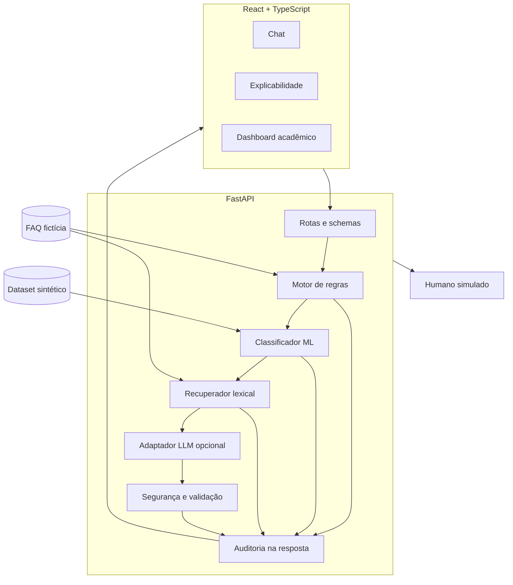

# Arquitetura técnica

## 1. Visão geral

O projeto é um monólito modular local. FastAPI concentra contrato HTTP e
orquestração; módulos separados implementam regras, ML, recuperação e LLM. React
consome a API e apresenta resposta e auditoria. Não existem microserviços, banco
de dados, fila real, banco vetorial ou agente autônomo.



## 2. Componentes

| Componente | Responsabilidade | Implementação |
| --- | --- | --- |
| Aplicação | Inicialização, metadados e CORS local | `backend/app/main.py` |
| Rotas | `/health` e `/support/messages` | `backend/app/api/routes.py` |
| Schemas | Contratos Pydantic e enums | `backend/app/schemas.py` |
| Regras | Correspondência determinística e respostas autorizadas | `backend/app/services/rules.py` |
| Roteador | Precedência, fallback e auditoria | `backend/app/services/router.py` |
| Dataset | Leitura, deduplicação e split | `backend/app/ml/dataset.py` |
| Classificador | TF-IDF + LogisticRegression | `backend/app/ml/classifier.py` |
| Avaliação | Métricas e matriz de confusão | `backend/app/ml/evaluation.py` |
| Recuperador | TF-IDF e cosseno sobre a FAQ | `backend/app/knowledge/retriever.py` |
| LLM | Configuração, limites e chamada opcional | `backend/app/llm/provider.py` |
| Segurança | Injection, citações e alegações proibidas | `backend/app/llm/safety.py` |
| Frontend | Chat, dashboard e explicabilidade | `frontend/src/` |

## 3. Contratos HTTP

### 3.1 `GET /health`

Resposta atual:

```json
{
  "status": "ok",
  "stage": "foundation-backend"
}
```

`stage` é um identificador histórico preservado por compatibilidade; não descreve
o estágio acadêmico atual.

### 3.2 `POST /support/messages`

Entrada:

```json
{
  "message": "Meu cartão foi recusado mesmo com limite"
}
```

Restrições: texto obrigatório, espaços removidos nas extremidades, mínimo de um
caractere e máximo de 2.000.

Saída simplificada:

```json
{
  "correlation_id": "uuid",
  "route": "humano",
  "intent": "pagamento",
  "answer": "...",
  "requires_human": true,
  "audit": {
    "reason_code": "ML_INTENT_WITHOUT_AUTHORIZED_RESPONSE",
    "duration_ms": 1.23,
    "model_version": "tfidf-logreg-...",
    "ml_confidence": 0.35,
    "sources": [],
    "safety_result": "NO_RELEVANT_AUTHORIZED_SOURCE"
  }
}
```

Campos opcionais de auditoria incluem regra, fonte da regra, cobertura lexical,
fallback ML, provedor/modelo LLM, tokens e custo estimado.

## 4. Algoritmo de roteamento

1. validar a mensagem;
2. gerar ID de correlação e iniciar cronômetro;
3. aplicar regras;
4. se não houver regra, classificar intenção;
5. rejeitar fora de escopo quando a razão de tokens conhecidos for ≤ 0,20;
6. rejeitar baixa confiança quando a probabilidade máxima for < 0,35;
7. detectar padrões explícitos de prompt injection;
8. recuperar até dois trechos com score ≥ 0,18;
9. rejeitar ausência, incompatibilidade de intenção ou ambiguidade;
10. se LLM estiver desligada, escalar;
11. se habilitada, enviar somente os trechos autorizados;
12. exigir JSON, citações válidas e resposta verificável;
13. bloquear valores, prazos numéricos e alegações individuais;
14. responder ou escalar, sempre incluindo auditoria.

## 5. Regras implementadas

| Regra | Intenção | Resultado |
| --- | --- | --- |
| `FAQ-TRACKING-001` | entrega | orientação genérica autorizada |
| `FAQ-EXCHANGE-ESCALATE-001` | troca | humano; política ausente |
| `FAQ-REFUND-ESCALATE-001` | reembolso | humano; prazo ausente |

As regras operam sobre texto normalizado e não consultam sistemas externos.

## 6. Machine Learning

O pipeline usa TF-IDF de palavras com `(1, 2)` n-gramas, acentos removidos e
frequência sublinear, seguido de regressão logística balanceada. O adaptador
retorna intenção, probabilidade máxima, versão baseada em hash, razão de tokens
conhecidos e sinal de fora de escopo.

As probabilidades não foram calibradas. `0,35` é threshold heurístico do
protótipo.

## 7. Recuperação de conhecimento

A única fonte aceita é `knowledge/faq-exemplo.md`. O carregador espera exatamente
três itens conhecidos e atribui IDs estáveis:

- `faq-001-acompanhar-pedido`;
- `faq-002-troca`;
- `faq-003-reembolso`.

Não existe busca na web, banco vetorial ou ingestão dinâmica de documentos.

## 8. LLM opcional

`create_optional_llm_provider()` retorna `None` quando `LLM_ENABLED=false`, valor
padrão. Quando habilitado, o adaptador exige URL, chave e modelo. A chave é usada
somente no cabeçalho HTTP e não integra schemas ou auditoria.

Controles:

- timeout;
- máximo de chamadas por processo;
- máximo de tokens de entrada e saída;
- orçamento estimado a partir de taxas configuradas;
- temperatura zero;
- resposta JSON;
- fontes citadas;
- fallback em erro, timeout ou resposta inválida.

Nenhum provedor real foi testado. Compatibilidade com um endpoint específico não
está comprovada além do contrato exercitado por dublês.

## 9. Frontend

O frontend usa `VITE_API_URL`, com fallback para `http://127.0.0.1:8000`. Ele não
executa decisões de negócio. `types.ts` espelha os schemas da API; o chat envia
mensagens; o painel mostra a auditoria; e o dashboard contém constantes iguais às
métricas versionadas. Testes validam contrato, erro de conexão e consistência dos
19 casos e 13 acertos.

## 10. Segurança e privacidade

- dados exclusivamente sintéticos;
- nenhum segredo no Git;
- LLM off por padrão;
- CORS limitado ao Vite local;
- contexto recuperado tratado como dado não confiável;
- prompt injection detectado por padrões;
- fonte em allowlist;
- fallback humano em falhas;
- nenhuma consulta ou mutação de pedido real.

Esses controles são experimentais e não substituem threat modeling, pentest,
autenticação, autorização, criptografia, observabilidade ou revisão de LGPD.

## 11. Configurações

| Variável | Padrão | Finalidade |
| --- | --- | --- |
| `ML_CONFIDENCE_THRESHOLD` | `0.35` | rejeitar baixa confiança |
| `ML_MIN_KNOWN_TOKEN_RATIO` | `0.20` | heurística de fora de escopo |
| `LLM_ENABLED` | `false` | habilitar integração opcional |
| `LLM_PROVIDER` | `openai_compatible` | identificador do adaptador |
| `LLM_API_BASE_URL` | vazio | endpoint autorizado |
| `LLM_API_KEY` | vazio | credencial somente em ambiente |
| `LLM_MODEL` | vazio | modelo autorizado |
| `LLM_TIMEOUT_SECONDS` | `10` | timeout |
| `LLM_MAX_CALLS` | `20` | limite em memória por processo |
| `LLM_MAX_INPUT_TOKENS` | `2000` | limite estimado de entrada |
| `LLM_MAX_OUTPUT_TOKENS` | `300` | limite solicitado de saída |
| `LLM_MAX_BUDGET_USD` | `1.00` | teto estimado |
| `VITE_API_URL` | `http://127.0.0.1:8000` | URL do backend |

## 12. Divergências históricas conhecidas

- a descrição OpenAPI ainda menciona “Etapa 1”;
- `/health.stage` ainda retorna `foundation-backend`;
- `docs/avaliacao-llm.md` registra 39 testes, número correto no marco da Etapa 3;
- o estado final possui 41 testes backend e 6 frontend.

Esses itens não alteram o comportamento aprovado. Os documentos finais usam o
estado atual e preservam os relatórios de etapa como histórico.
