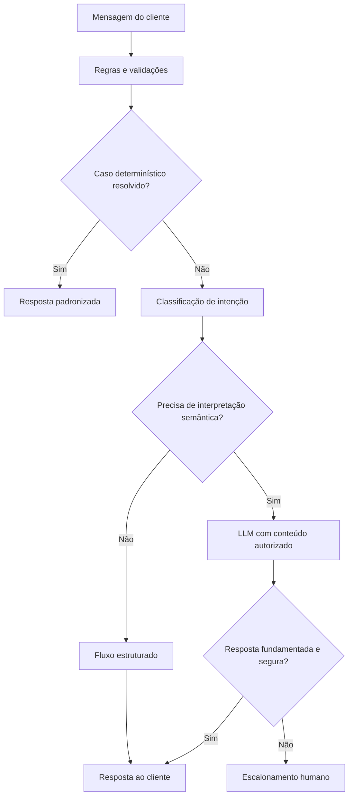

# Arquitetura proposta (conceitual)

## Controles obrigatórios para futura implementação
- Consulta apenas a FAQs e políticas autorizadas; não inventar status, prazo ou reembolso de pedidos.
- Não incluir dados pessoais reais na prova de conceito.
- Resposta sem fonte suficiente deve levar ao atendimento humano.
- Registrar qual rota produziu a resposta e seus motivos.
- Definir limites de custo, testes e monitoramento antes do uso de API externa.
