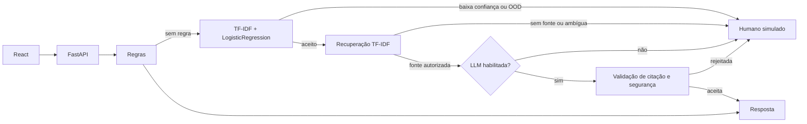

# Relatório final M1D1 — Avaliação de IA para atendimento em e-commerce

## Resumo executivo

Este micro-capstone avalia um caso fictício de e-commerce com aproximadamente
25.000 solicitações mensais, tempo médio inicial de resposta de 9 horas e
atendimento 100% humano. O problema é reduzir tempo e custo sem comprometer
qualidade, confiança, privacidade ou rastreabilidade.

A solução implementada é um monólito modular com quatro camadas decisórias:
regras determinísticas, classificação de intenção por Machine Learning,
recuperação lexical de conhecimento autorizado e integração opcional com LLM,
sempre com escalonamento humano. A interface React demonstra o fluxo e apresenta
a trilha de decisão e os resultados experimentais.

O baseline de ML obteve accuracy de 0,684 e macro F1 de 0,689 em um teste
sintético de 19 casos. Com thresholds de segurança, o ML não ampliou a cobertura
em relação às regras nesse conjunto. Nenhuma LLM real foi chamada ou avaliada.
Portanto, a evidência sustenta uma prova de conceito acadêmica reproduzível, não
uma solução pronta para produção.

## 1. Problema e objetivos

### 1.1 Dados fornecidos pelo caso

- aproximadamente 25.000 solicitações de suporte por mês;
- tempo médio inicial de resposta de 9 horas;
- atendimento 100% humano;
- percepção qualitativa de custo operacional elevado;
- objetivo de reduzir tempo e custo sem comprometer qualidade.

Não foram fornecidos dados reais de custo por contato, distribuição de intenções,
CSAT, reabertura, abandono, SLA, políticas comerciais ou histórico rotulado.

### 1.2 Objetivo geral

Avaliar a viabilidade técnica e os riscos de uma arquitetura de IA híbrida para
triagem e resposta controlada em suporte de e-commerce.

### 1.3 Objetivos específicos

1. identificar casos adequados a regras;
2. medir um baseline de classificação de cinco intenções;
3. limitar respostas sem fonte autorizada;
4. preservar explicabilidade e rastreabilidade;
5. demonstrar fallback humano;
6. produzir evidências reproduzíveis sem dados pessoais ou APIs pagas.

## 2. Natureza do problema

O caso combina naturezas distintas:

- **determinística:** regras e políticas autorizadas podem ser aplicadas de forma
  previsível;
- **classificatória:** mensagens em linguagem natural precisam ser associadas a
  intenções;
- **semântica:** variações linguísticas podem exigir recuperação e interpretação;
- **decisória:** o sistema precisa saber quando não responder;
- **operacional:** exceções devem ser entregues a pessoas.

Não há necessidade demonstrada de agentes autônomos. O sistema não executa ações
em pedidos, pagamentos ou logística.

## 3. Alternativas avaliadas

### 3.1 Regras determinísticas

Adequadas quando a intenção e a resposta autorizada são claras. Oferecem baixo
custo, consistência e auditoria direta. Neste projeto, rastreio genérico recebe
orientação; troca e reembolso são reconhecidos, mas escalonados porque a FAQ não
contém política ou prazo oficial.

### 3.2 Machine Learning

O baseline TF-IDF + LogisticRegression identifica `entrega`, `troca`,
`reembolso`, `pagamento` e `cancelamento`. Sua função é classificar e apoiar o
roteamento. Probabilidade não é autorização para responder.

### 3.3 LLM controlado

O adaptador opcional aceita somente trechos recuperados da FAQ autorizada, exige
resposta estruturada e citações, aplica limites e validações pós-resposta. Ele
fica desligado por padrão. Os testes utilizam dublês locais; nenhuma LLM real foi
avaliada.

### 3.4 Matriz comparativa

| Alternativa | Benefício | Limitação principal | Custo relativo | Explicabilidade | Estado no projeto |
| --- | --- | --- | --- | --- | --- |
| Regras | Previsibilidade | Baixa flexibilidade linguística | Baixo | Alta | Implementada |
| ML clássico | Roteamento de intenções | Depende de dados e calibração | Baixo/médio | Média/alta | Baseline implementado |
| LLM controlado | Geração contextual | Alucinação, custo e governança | Variável | Média/baixa | Adaptador opcional, não validado com modelo real |
| Agente autônomo | Ações e planejamento | Complexidade e risco excessivos | Alto | Baixa | Deliberadamente não implementado |

## 4. Aplicação dos cinco critérios de decisão

### 4.1 Previsibilidade

Perguntas padronizadas favorecem regras. Por isso, regras têm precedência sobre
ML e LLM.

### 4.2 Necessidade semântica

Variações linguísticas justificam classificação e recuperação, mas a pequena FAQ
e o dataset sintético limitam a evidência de ganho semântico.

### 4.3 Complexidade proporcional

Um monólito modular, SQLite ausente e processamento em memória são suficientes
para o capstone. Microserviços, banco vetorial, fine-tuning e agentes autônomos
foram evitados.

### 4.4 Volume e qualidade dos dados

O volume mensal torna ML plausível, mas não há tickets reais ou rótulos reais.
O experimento usa 125 mensagens sintéticas balanceadas; isso permite
reprodutibilidade, não generalização para produção.

### 4.5 Explicabilidade e governança

A API registra ID de correlação, rota, motivo, duração, versão do modelo,
confiança, fontes, provedor, tokens, custo estimado e resultado de segurança
quando aplicáveis. Casos incertos são escalonados.

## 5. Arquitetura e justificativa



O monólito reduz infraestrutura e facilita reprodução. Portas tipadas desacoplam
classificador e provedor LLM. A FAQ local funciona como allowlist de conhecimento.
O frontend não contém lógica de decisão: consome o contrato da API e apresenta a
auditoria.

## 6. Metodologia experimental

### 6.1 Dados

Foram criadas 125 mensagens sintéticas em português brasileiro, 25 por classe.
O carregador rejeita IDs e mensagens duplicadas após normalização.

### 6.2 Divisão

- seed fixa: 42;
- treino: 87;
- validação: 19;
- teste: 19;
- divisão estratificada;
- IDs disjuntos entre os conjuntos.

### 6.3 Modelo

- TF-IDF de palavras;
- unigramas e bigramas;
- normalização de acentos;
- frequência sublinear;
- LogisticRegression com `C=1.0`, `class_weight="balanced"`,
  `max_iter=1000` e `random_state=42`.

O experimento ajusta o modelo somente no treino. O adaptador usado pela API é
treinado em memória com o dataset completo após a avaliação, distinção que evita
confundir desempenho experimental com uso demonstrativo.

### 6.4 Métricas

Accuracy, precision macro, recall macro, macro F1, métricas por classe e matriz de
confusão. A comparação de estratégias usa acertos e cobertura sobre o mesmo teste
sintético.

## 7. Resultados medidos

### 7.1 Classificação

| Conjunto | Accuracy | Precision macro | Recall macro | Macro F1 |
| --- | ---: | ---: | ---: | ---: |
| Validação | 0,579 | 0,567 | 0,567 | 0,559 |
| Teste | 0,684 | 0,733 | 0,700 | 0,689 |

Matriz de confusão do teste. Linhas são classes reais; colunas são classes
preditas, na ordem entrega, troca, reembolso, pagamento e cancelamento:

```text
[[3, 0, 0, 0, 1],
 [0, 3, 0, 0, 0],
 [0, 1, 2, 1, 0],
 [1, 0, 0, 3, 0],
 [0, 0, 0, 2, 2]]
```

A matriz soma 19 casos e 13 acertos. `13 / 19 = 0,6842105263`, consistente com a
accuracy. A meta futura de macro F1 0,80 não foi atingida.

### 7.2 Estratégias

| Estratégia | Cobertos | Acertos | Accuracy total | Cobertura |
| --- | ---: | ---: | ---: | ---: |
| Regras isoladas | 4 | 3 | 0,158 | 0,211 |
| Regras + ML seguro | 4 | 3 | 0,158 | 0,211 |
| Regras + ML bruto, diagnóstico | 19 | 12 | 0,632 | 1,000 |

Com thresholds seguros, 15 mensagens foram rejeitadas e o ML não ampliou a
cobertura nesse teste. A linha bruta é apenas diagnóstica e não representa a API.

### 7.3 Engenharia

- 41 testes backend aprovados;
- 6 testes frontend aprovados;
- build Vite aprovado, 36 módulos transformados;
- integração HTTP local e CORS local verificados;
- nenhuma chamada externa ou paga;
- nenhuma avaliação de LLM real.

## 8. Análise crítica

O principal resultado não é desempenho elevado, mas a demonstração de controles.
O macro F1 abaixo da meta e a ausência de ganho seguro de cobertura impedem uma
recomendação de produção. O balanceamento artificial favorece uma avaliação
limpa, mas não reflete prevalência real. A regra de precedência também pode
corrigir ou prejudicar uma previsão; no teste, o híbrido bruto acertou 12 casos,
um a menos que o classificador isolado.

O fallback humano é coerente com o risco, porém não existe fila, SLA ou estudo de
carga. A recuperação de três trechos prova rastreabilidade, não suficiência de
conhecimento. Os guardrails de LLM são úteis como defesa em profundidade, mas não
garantem correção semântica.

## 9. Mapa de riscos

| Risco | Nível acadêmico | Controle implementado | Risco residual |
| --- | --- | --- | --- |
| Alucinação | Alto | Fonte autorizada, citação, validação e fallback | Validação lexical não prova fatos |
| Política incorreta | Alto | FAQ em allowlist e ausência de resposta sem fonte | FAQ fictícia e incompleta |
| Privacidade/LGPD | Alto | Dados exclusivamente sintéticos | Não houve auditoria jurídica |
| Prompt injection | Médio | Delimitação, prompt de sistema, padrões e fallback | Padrões podem ser contornados |
| Baixa confiança ML | Médio | Threshold e detector lexical de OOD | Probabilidades não calibradas |
| Custo de API | Médio | LLM off, limites e orçamento | Taxas manuais podem estar erradas |
| Indisponibilidade | Médio | Timeout e fallback humano | Sem observabilidade operacional |
| Perda de confiança | Médio | Explicabilidade e transparência | Não houve teste com usuários |

## 10. Anti-patterns evitados

- LLM aplicada indiscriminadamente;
- probabilidade tratada como verdade ou autorização;
- resposta sem fonte suficiente;
- dados pessoais reais no protótipo;
- segredo versionado;
- banco vetorial sem necessidade;
- microserviços prematuros;
- agentes autônomos para um fluxo de triagem;
- fine-tuning sem dataset adequado;
- métricas de negócio inventadas;
- apresentação de dublês de teste como LLM real;
- ML bruto apresentado como política segura.

## 11. Limitações

1. dados e FAQ sintéticos;
2. somente 19 exemplos no teste;
3. ausência de distribuição real das intenções;
4. ausência de mensagens multilabel e variação realista suficiente;
5. probabilidades não calibradas;
6. heurística lexical de fora de escopo;
7. recuperação sobre apenas três trechos;
8. LLM real não avaliada;
9. escalonamento humano simulado;
10. ausência de autenticação, persistência e integrações reais;
11. sem testes de carga, segurança independente ou LGPD formal;
12. validação visual automatizada indisponível na sessão final de desenvolvimento;
13. nenhuma evidência de economia, CSAT ou redução do tempo de 9 horas.

## 12. Recomendação final e conclusão

A arquitetura híbrida é recomendada como direção técnica para uma próxima prova
de conceito, não como autorização de produção. Regras devem permanecer na frente
do pipeline; ML deve ser retreinado e calibrado com dados representativos; fontes
devem ser oficiais e versionadas; e o humano deve permanecer responsável por
casos sem evidência ou de maior risco.

Antes de um piloto, recomenda-se obter políticas oficiais, dataset anonimizado e
rotulado, baseline operacional, critérios de segurança, avaliação humana,
observabilidade, autenticação e revisão de LGPD. A avaliação de uma LLM real deve
ser separada, limitada por orçamento e comparada contra respostas humanas e
fluxos sem geração.

O capstone atende ao objetivo acadêmico de comparar alternativas e materializar
uma arquitetura explicável, de baixo custo e reproduzível. Seus resultados devem
ser apresentados como evidência experimental sintética, nunca como desempenho de
uma empresa real.
